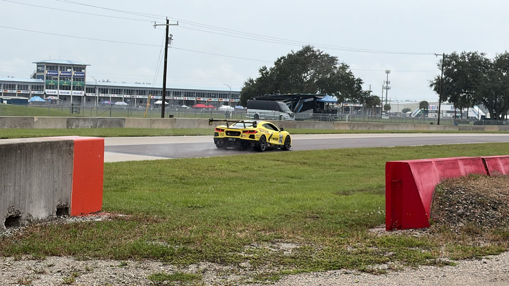
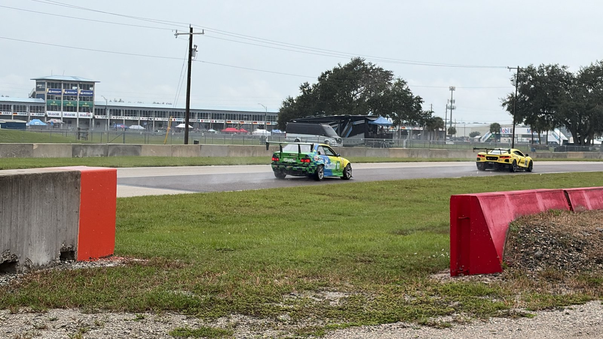
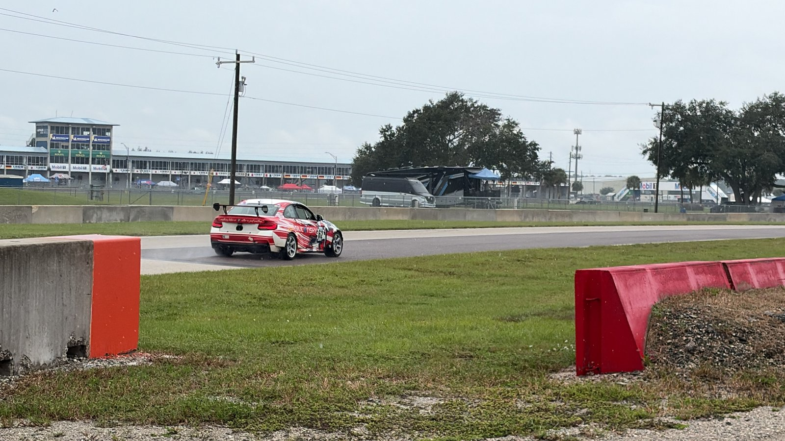
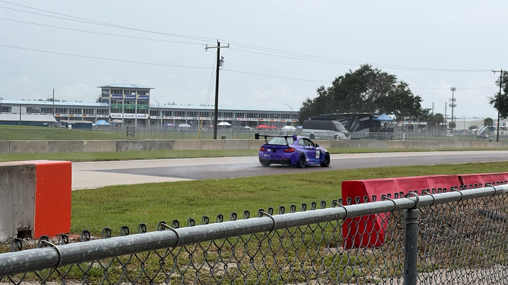
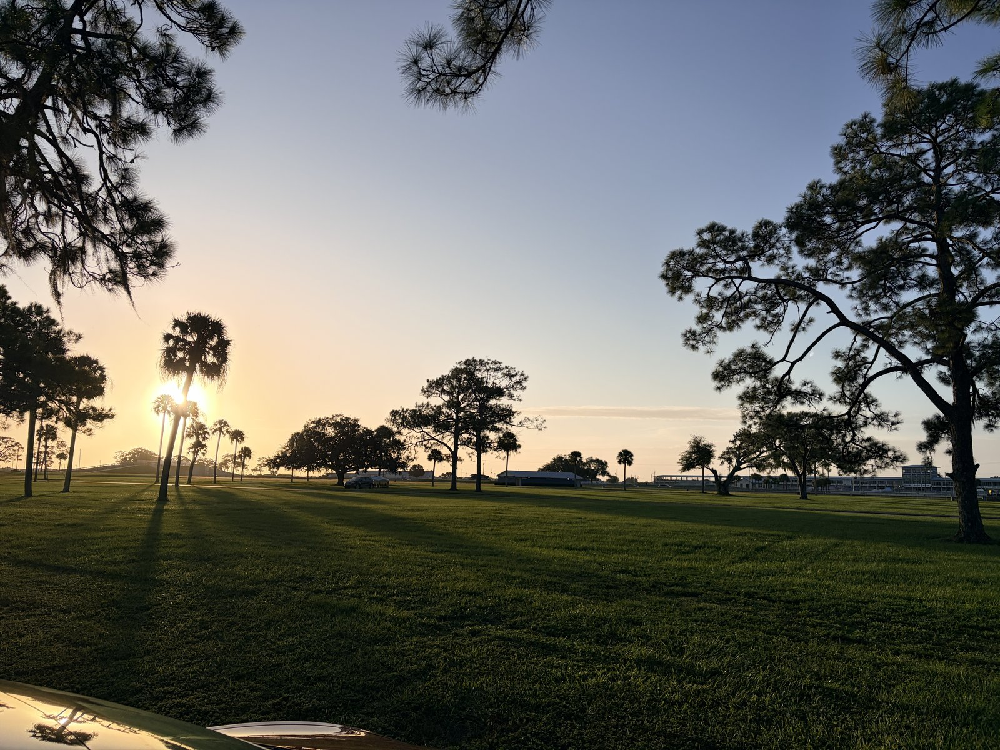
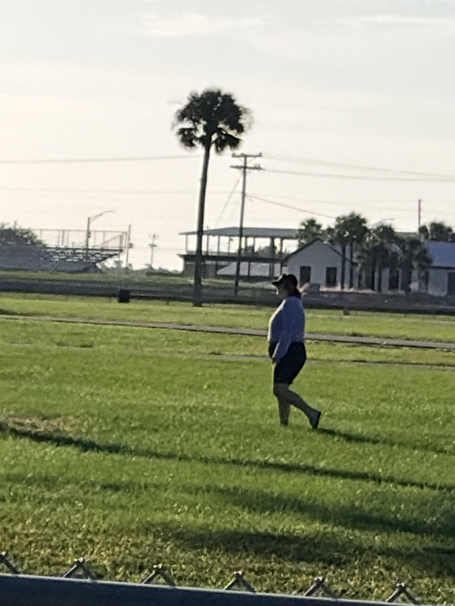
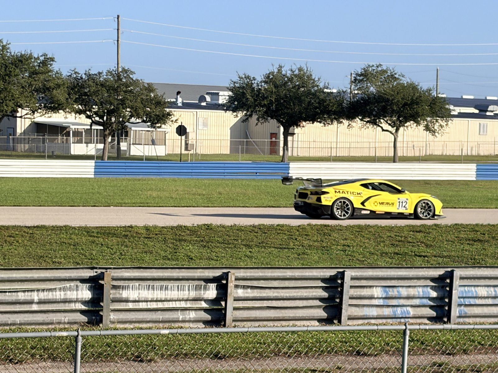
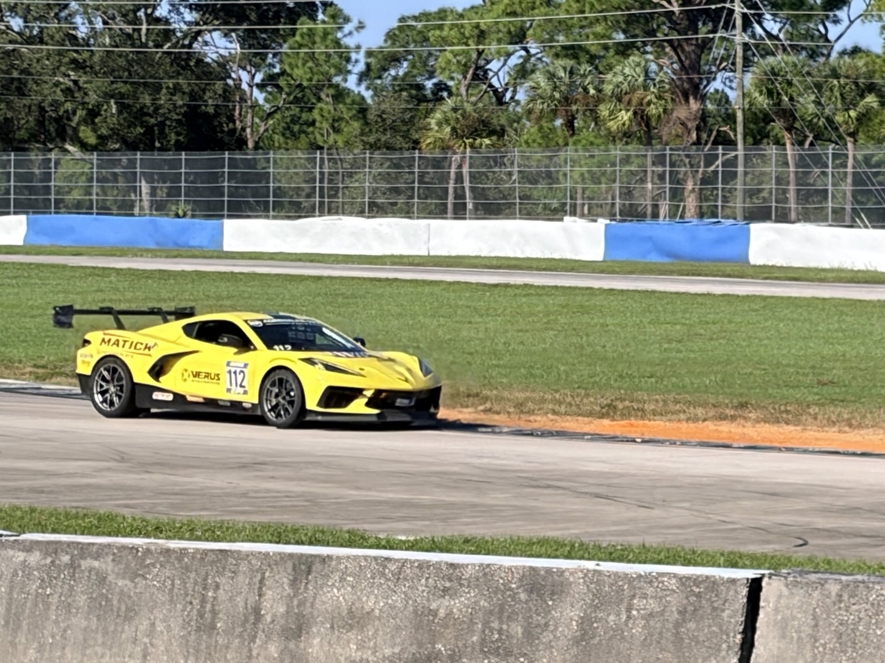
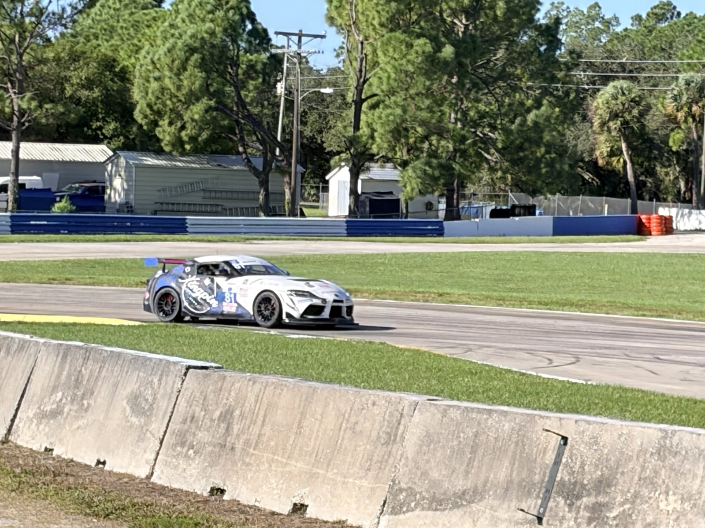
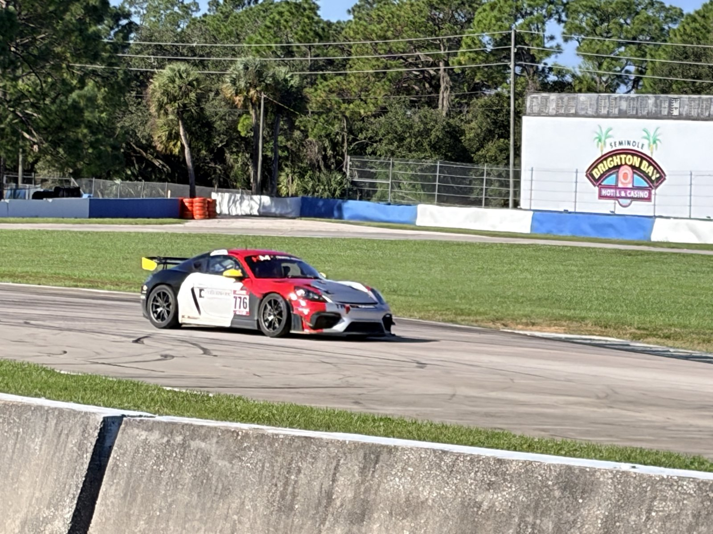

Some race weekends feel like a checklist. This one felt like a story. My fiancée and I headed to Sebring for the <a href="https://www.racewrl.com/sebring26"><strong>World Racing League @ Sebring 2026</strong></a> — WRL's Eastern Championship finale and the ninth round of the 2026 National Championship — rolled in Saturday, stayed overnight, and left Sunday with wet shoes, a crooked tent story, and a hard time picking a favorite car… until that yellow Corvette kept coming back around.

WRL billed the weekend as <strong>Test + 8 + 7</strong>: testing Friday, an <strong>8-hour endurance race Saturday</strong> (scheduled to finish around 5 PM), and a <strong>7-hour race Sunday</strong> (scheduled to finish around 3 PM). Four classes on track — GTO, GTU, GP1, and GP2 — on Sebring's famous 17-turn layout, the place WRL still calls the “birthplace of American Endurance Racing.” Fifteen hours of racing across the weekend if you stay for both days. We came for the vibe as much as the stopwatch.

<h3>🌧️ Saturday: Magical Racing Into the Evening (and Then the Weather)</h3>

Saturday afternoon into the evening was the magical part. The 8-hour race was already deep into its stints when we settled in trackside, and the field just kept coming — GT cars, club builds, everything in between. Overcast skies, dark asphalt, and that Sebring infield stretch with the hotel and grandstands sitting out past the barriers. You could feel the weekend settling in.

<figure><figcaption>Saturday afternoon: the yellow No. 112 Corvette kicks up mist on a damp track, Sebring hotel and grandstands in the distance.</figcaption></figure>

And then I saw it properly for the first time — that <strong>bright yellow Corvette</strong>, No. 112, MATICK / VERUS ENGINEERING all over the flanks, big black wing, absolutely glowing against the gray sky. Even in the wet it looked like the main character.

<figure><figcaption>Green car, yellow Corvette in tow — multi-class traffic working the same piece of damp Sebring asphalt.</figcaption></figure>

<figure><figcaption>Red car blasting past the barrier. Saturday's light stayed flat and gray, and the track never really looked dry.</figcaption></figure>

<figure><figcaption>Teal wing car through the same corner. WRL's power-to-weight classes put a wild mix of shapes on track together.</figcaption></figure>

<figure>
<video controls playsinline preload="metadata" poster="/assets/img/wrl-sebring-2026-vid-sat-racing-poster.jpg">
<source src="/assets/img/wrl-sebring-2026-vid-sat-racing.mp4" type="video/mp4">
</video>
<figcaption>Saturday trackside: multi-color No. 2 GT car and a red-and-white chase car rip past under the gray sky.</figcaption>
</figure>

We survived the rain Saturday. Not a monsoon epic, just that Sebring kind of weather where the sky never quite commits and the track keeps a sheen on it. Cars were throwing mist. The air got colder as the afternoon leaned into evening. Watching the 8-hour grind from afternoon into the evening lights coming on… yeah. Magical is the right word.

Camping overnight in the paddock / infield area is part of the deal at a weekend like this — WRL lists camping on the event page, and the spectator side makes it easy to stay close to the action. We got set up, made it through the wet Saturday, and figured we'd be fine for Sunday.

The wind had other plans.

<h3>💨 The Tent vs. Sebring Wind</h3>

Sometime in there the wind got strong enough to knock the tent over. Not a gentle lean — over. We got cut short because of it. You pack for rain at Sebring in October. You don't always pack for the wind deciding your architecture is a suggestion. We survived it, laughed about it, and still woke up on site for Sunday. But yeah… the weekend got abbreviated a little earlier than we wanted.

<h3>🌅 Sunday: Crisp Cold Morning &amp; the Star-Spangled Banner</h3>

Sunday morning was a completely different movie. Crisp. Cold. Clear blue instead of Saturday's gray. The sun came up through the palms and pines across the infield grass, long shadows everywhere, and for a minute Sebring felt quiet enough that you could hear your own footsteps.

<figure><figcaption>Sunday sunrise from camp — palms, pines, long shadows, and the track waking up on the horizon.</figcaption></figure>

And then the national anthem. The Star-Spangled Banner echoed throughout the track — not just from one speaker near us, but bouncing around the whole place. On a cold Sunday morning at Sebring, with the 7-hour still ahead, that hit different. Another race day in the books, and it hadn't even started yet.

<figure><figcaption>Sunday morning walk with my fiancée — palm tree, clear sky, and the whole place still waking up.</figcaption></figure>

By mid-morning the 7-hour field was circulating under that perfect Florida blue. Totally different light from Saturday. Every car looked sharper. Every color hit harder.

<h3>💛 Favorite of the Weekend: The Yellow Corvette</h3>

I already knew what my favorite was. That yellow Corvette — No. 112 — kept finding me. Saturday in the mist. Sunday in the sun. Big wing, yellow paint so loud it felt like it had its own soundtrack. MATICK across the rear quarter, VERUS ENGINEERING on the door. Every time it came by I stopped whatever else I was doing.

<figure><figcaption>Sunday profile shot — No. 112 glowing under a clear blue sky past the blue-and-white Sebring curb.</figcaption></figure>

<figure><figcaption>My favorite of the weekend, no contest. Yellow Corvette No. 112, trackside on Sunday.</figcaption></figure>

<figure>
<video controls playsinline preload="metadata" poster="/assets/img/wrl-sebring-2026-vid-sun-morning-poster.jpg">
<source src="/assets/img/wrl-sebring-2026-vid-sun-morning.mp4" type="video/mp4">
</video>
<figcaption>Yellow Corvette No. 112 blasting past the hotel on Sunday — the one that made the weekend.</figcaption>
</figure>

There was plenty else to love. A white-and-blue Supra-looking GT car. A red-and-white Porsche shape ripping past the barrier. A whole parade of BMWs and club builds in every color you can name. That's the WRL mix — factory-ish GT machinery and home-built endurance cars sharing the same 15-hour weekend.

<figure><figcaption>White-and-blue Supra-style GT car on Sunday — clean livery, big wing, perfect light.</figcaption></figure>

<figure><figcaption>Red-and-white Porsche shape through the same Sunday stretch. The field never got boring.</figcaption></figure>

<h3>📸 Full Album</h3>

I shot a bunch more than what fits here — photos and videos from both days. Here's the full shared album if you want the unedited dump:

👉 <a href="https://photos.icloud.com/shared/album/0161VoB2HNgobuGZw3NB2tdvg">https://photos.icloud.com/shared/album/0161VoB2HNgobuGZw3NB2tdvg</a>

<h3>❤️ Final Thoughts</h3>

We came Saturday, left Sunday, got rained on, got wind-checked by a tent that lost an argument with Sebring air, and still walked away calling it magical. Watching that 8-hour into the evening. Hearing the anthem echo on a cold Sunday morning. Spotting the yellow Corvette one more time before we packed up.

WRL's Sebring stop is the Eastern Championship finale for a reason. If you've only done Sebring for the 12 Hours, put a club endurance weekend on the list. Bring layers. Stake the tent down better than we did. And keep an eye out for the yellow one.

Event info from WRL: <a href="https://www.racewrl.com/sebring26">racewrl.com/sebring26</a>. Spectator / watch page: <a href="https://www.racewrl.com/watchsebring">racewrl.com/watchsebring</a>.

I'll be back. Next time with better tent stakes. 🏁

<strong>— Darien</strong>

